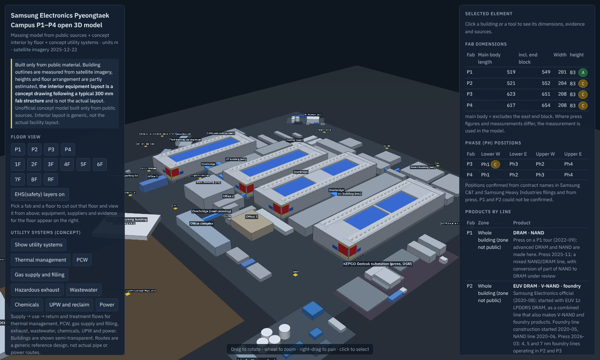

# Samsung Electronics Pyeongtaek Campus P1–P4 — open 3D model (unofficial), v7.21 (English edition)

An educational, open-source 3D model of the world's largest semiconductor manufacturing cluster, built **only from public material**.

> **Unofficial.** This project is not affiliated with, endorsed by, or reviewed by Samsung Electronics or any other company named here. No non-public drawings, internal documents or information obtained through site access were used. Building outlines are measured from public satellite imagery. Heights and floor arrangement are partly estimated. **The interior equipment layout, utility routes and EHS layers are a generic reference design (concept), not the actual facility layout.** Positions of security equipment (cameras, access control, guard routes) are deliberately not modelled. No company logos are used.



## At a glance

| Item | Content |
|---|---|
| Scope | The wider Pyeongtaek complex: fabs P1, P2, P3, P4, the EUV building (V2), utility buildings, cooling tower banks, office and support buildings, the KEPCO Godeok substation lot, the Linde Korea plant, the Godeok public wastewater treatment plant, the P5 construction site, the Air Products and Air First gas plants, the Samsung logistics warehouse west of Complex 2, and map points for supplier sites and construction camps |
| Building elements | 1,327 boxes with name, layer, confidence grade, source keys and a note each |
| Concept interior | 86,620 equipment boxes of 26 types on 8 floors per fab, 608 OHT rail segments, 10,440 structural members |
| Concept utilities | 29 systems in 8 groups, 1,521 route segments (thermal, PCW, gas, exhaust, wastewater, chemicals, UPW, power) |
| Concept EHS | 960 gas/exhaust flow lines, 1,152 gas detector points, 1,552 emergency equipment points, 15,320 egress travel-distance samples |
| Sources | 173 keyed sources in three tiers: 34 official/register/map, 41 international (Reuters, TrendForce, DIGITIMES, Linde, Air Products, GE Vernova, journals, patents, standards), 98 Korean press and local |
| Units, origin | metres; local tangent plane at WGS84 37.02 N, 127.06 E; X east, Y north, Z up |
| Imagery date | 2025-12-22 (0.5 m) for dimensions; zoom-18 mosaic re-acquired 2026-11-12 for re-checks |

## Files

| Path | Content |
|---|---|
| `viewer/index.html` | Single-file browser viewer that works offline (data and three.js r128 are inlined). Fab and floor selection, section cuts, layer toggles, EHS and utility layers, click for evidence and sources |
| `models/pyeongtaek_p1-p4_full.glb` | Whole model, glTF binary (15 MB) |
| `models/pyeongtaek_p1-p4_full.obj` + `material.mtl` | Whole model, OBJ (60 MB) |
| `models/pyeongtaek_p1-p4_exterior.stl` | Exterior shell only (for printing or massing) |
| `models/pyeongtaek_p1-p4_buildings.step` | CAD solids: buildings, slabs, zones, support rooms (equipment excluded for size) |
| `models/pyeongtaek_p1-p4_3d.dxf` | 3D DXF, 166 layers |
| `drawings/layout_plan_2d.dxf` | 2D layout plan in model coordinates, 178 layers such as `3F_ETCH`, `3F_EHS_EGRESS_DIST_M` |
| `drawings/floor_plans/` | 36 floor plans (4 fabs × 9 levels) with supplier legends |
| `drawings/ehs/` | 4 egress travel-distance screening sheets (lower cleanroom) |
| `drawings/utility/` | Campus utility concept plans and a flow summary sheet |
| `data/campus.json` | The full model as data (everything the viewer and exports are made from) |
| `data/*.csv` | Elements, equipment, floors, phases, vendors, structure, EHS and utility tables |
| `preview/` | 27 screenshots of the viewer |
| `src/` | Export, viewer and check scripts that run on `data/campus.json`; `src/generator_ko/` holds the original generator and the translation tables (see "Rebuilding") |
| `SOURCES.md` | All 173 sources with URLs, grouped by tier |
| `CONSULTATION.md` | Record of what other AI models proposed and what was adopted, verified, held or rejected |

## Coordinates

- Local metric frame: `X = (lon − 127.06) × 88,782`, `Y = (lat − 37.02) × 111,194.9`, Z up from ground.
- `data/*.csv` and `drawings/layout_plan_2d.dxf` use these coordinates directly.
- The 3D exports (GLB, OBJ, STL, STEP, 3D DXF) are shifted by −1,500 m in Y so that the campus sits near the origin. GLB uses the glTF convention (Y up).
- Rotated boxes carry `rot` in degrees, counter-clockwise about Z around the box centre.

## Confidence grades

| Grade | Meaning |
|---|---|
| A | Confirmed by official material, press or regulatory filings |
| B | Dimensions estimated from public satellite imagery (0.5 m resolution, error of a few metres) |
| M | Confirmed by a public map label or the public building register (a map coordinate may be an entrance or a representative point, not a building outline) |
| C | Estimate or assumption |
| D | Generic concept, not site-specific information |

Existence, building match, location, shape and numbers are graded separately in the notes. A request to "make it definite" does not raise a grade; only a source does.

## Source priority

Source priority: (1) official material and filings of Samsung Electronics and its contractors, and public registers; (2) international wire services and trade media outside Korea (Reuters, TrendForce, DIGITIMES, etc.); (3) Korean press. Where one fact has several sources, the higher tier is listed first. International outlets often cite Korean reports, so the original report is kept alongside.

Korean press still makes up most of the list because contract amounts, phase names, the substation, water volumes and permits are reported in detail only locally; `SOURCES.md` explains this and groups every source by tier.

## Fab dimensions and cleanroom area

| Fab | Main body (m) | Incl. east end block (m) | Width (m) | Height (m) | Model cleanroom area, two levels (㎡) | Brokerage report figure (㎡) |
|---|---|---|---|---|---|---|
| P1 | 519 | 549 | 201 | 83 (A) | 135,598 | about 135,300 |
| P2 | 521 | 552 | 204 | 83 (C) | 138,908 | about 148,500 |
| P3 | 623 | 651 | 208 | 83 (C) | 174,748 | about 181,500 |
| P4 | 617 | 654 | 208 | 83 (C) | 172,852 | about 181,500 |

- P1: official and press figures (518–520 m × 200–201 m × 83 m) agree with the satellite measurement.
- P2, P3, P4 heights are not public; in drone photos taken from the west the four fabs look about the same height, so P1's 83 m is assumed.
- Press figures that disagree with the measurement (for example "P3 700 m") are recorded in the notes; the measurement is used.
- Area policy: official material of Samsung Electronics, Samsung C&T, Samsung E&A and Samsung Heavy Industries comes first; press figures are reference only. Official figures found: campus site 2.89 million㎡ / 2.83 million㎡ (Samsung newsrooms), whole Pyeongtaek complex total floor area 3,967,000㎡ (Samsung C&T portfolio), P2 total floor area 128,900㎡ (Samsung Newsroom). No per-building areas for P1, P3 or P4 were found in official material.

## Floor arrangement (estimated; floor heights are assumed)

| Level | Elevation (m) | Use |
|---|---|---|
| RF | 66– | Roof: exhaust scrubbers, fans, stacks, pipe racks |
| 8F | 56–66 | FFU plenum and roof truss (upper) |
| 7F | 48.5–56 | Upper cleanroom (FAB) |
| 6F | 41–48.5 | CSF · clean subfab (upper) |
| 5F | 33–41 | FSF · utility subfab (upper) |
| 4F | 24–33 | FFU plenum and truss (lower) |
| 3F | 16.5–24 | Lower cleanroom (FAB) |
| 2F | 9–16.5 | CSF · clean subfab (lower) |
| 1F | 0–9 | FSF · utility subfab (lower) |

Public basis: 8 floors above ground (construction supervisor record for P2), four cleanrooms on two levels (trade press), a visitor window corridor on P1 3F (press), and the FAB + CSF + FSF three-level structure of 300 mm lines (peer-reviewed occupational hygiene paper).

## Phase positions (P3, P4)

| Fab | Lower west | Lower east | Upper west | Upper east |
|---|---|---|---|---|
| P3 | Ph1 (C, inferred) | Ph3 (A) | Ph2 (A) | Ph4 (A) |
| P4 | Ph1 (A) | Ph2 (A) | Ph3 (A) | Ph4 (A) |

Positions come from the contract names in regulatory filings by Samsung C&T, Samsung E&A and Samsung Heavy Industries (for example "P4 Ph1 (lower west) FAB building / complex building finishing work"). P1 and P2 could not be confirmed.

## Surrounding facilities (added in v7.17)

Model extent is now about 3.9 km × 3.6 km (X −1,950 to 1,950 m, Y −650 to 2,900 m).

| Facility | Basis for identity | Geometry | What is modelled |
|---|---|---|---|
| Air Products Korea Pyeongtaek plant (northeast, adjacent) | Kakao Map and Google Maps labels; company press releases | Read from zoom-18 satellite imagery, ±5 m | Site pad, 3 domed tanks, 4 buildings, process equipment area, 2 cooling towers |
| Air First Pyeongtaek plant (about 1 km south) | Kakao Map label; press | Read from satellite imagery | Site pad, 2 domed tanks, 3 building groups, process equipment area |
| Samsung Electronics logistics warehouse (west of Complex 2, Godeok-dong 1696-1) | Kakao Map label | Read from satellite imagery: about 177 × 320 m, height about 21 m from shadow length | Main building and 3 annexes |
| Linde Korea plant, Godeok public wastewater treatment plant, KEPCO Godeok lot | Building register and map labels (earlier versions) | Imagery | As before |
| Samsung E&A construction camps, SEMES office, Wonik IPS site, Hanyang ENG | Kakao Map labels | Points only | Map markers |

- **Logistics warehouse**: press in 2025-12 reported that the CDC logistics centre on the planned P6 site would be demolished by May 2026 and that the demolition permit had been issued. A CDC (Central Distribution Center) handles finished products, and Samsung Electronics is building a home-appliance CDC of about 110,000㎡ in the Pyeongtaek Poseung district (started 2025-03, completion targeted 2027-06). Read together, this is a product distribution centre being relocated, not a fab materials warehouse being closed. No source states directly that the modelled building is that CDC or that Poseung replaces it, so both are inferences; the imagery is dated 2025-12-22 and the current state was not confirmed.
- **What each neighbour supplies** (from company material, filings and press; stored in each element's note):

| Company | Role at Pyeongtaek | Basis |
|---|---|---|
| Air Products Korea | Nitrogen, oxygen, argon, hydrogen; ultra-high-purity nitrogen plants, hydrogen generators, a liquefier, bulk specialty gas supply system; supplies fab 1 | Company press release, trade press, Korean press |
| Air First | Oxygen, nitrogen, argon, hydrogen by underground pipeline to P3 and P4; ASU and SMR at the plant | Press; company job posting |
| Linde Korea | Main industrial gas supplier to the complex; eighth on-site air separation unit; on-site hydrogen | Company press releases |
| Samsung E&A | Green building, substation, complex building, air pollution control, UT building, rooftop exhaust, UPW, water treatment | Regulatory filings, project pages |
| SEMES | Overhead hoist transport (OHT) in P1 | Official video, tour press |
| Wonik IPS | Deposition equipment (PECVD, ALD, thermal); reported orders for the second Pyeongtaek fab | Company site, ETNews English |
| Hanyang ENG | General piping (P4, P5), hook-up and CCSS installation | Regulatory filings, press |

- A marker shows where a company has a site; what is done at that particular site was not confirmed.
- Tanks and process equipment are simplified as boxes; their heights are arbitrary. Uses of individual buildings inside the gas plants are estimates from shape.
- See `preview/24_surroundings_wide.png` to `27_air_first_plant.png`.

## Bridges and parking

- **17 bridges** in the layer `Connecting bridges`, drawn in bright blue and labelled in the viewer: overbridges between each fab and the utility building beside it, links to the EUV building, a road-crossing bridge to the office complex, and two truss pipe rack bridges. Press reports that buildings are linked by overbridges carrying people, wafers, gases and chemicals; the individual positions are read from satellite imagery, and heights are assumed.
- **Parking**: the Complex 2 parking building (public building register: 42,285.72㎡ building area, 20.99 m, 4 floors and 1 basement, 4,858 indoor spaces), the technology building parking tower and the office complex parking tower (public map labels), and the employee parking lot with its solar canopy (OSM boundary; canopy location estimated).
- See `preview/23_west_bridges_parking.png`.

## Products by line (official announcements and press only)

Only what appears in Samsung Electronics official announcements and press is listed. The zone inside a building is given only where it is public; otherwise it is marked 'zone not public'. Product mix changes often with demand, so read each entry with its date.

| Fab | Zone | Product | Basis | Source keys (highest tier first) |
|---|---|---|---|---|
| P1 | Whole building (zone not public) | **DRAM · NAND** | Press on a P1 tour (2022-09): advanced DRAM and NAND are made here. Press 2025-11: a mixed NAND/DRAM line, with conversion of part of NAND to DRAM under review | `PROD_P1N`, `INT_RTR_BIDEN`, `PROD_P1` |
| P2 | Whole building (zone not public) | **EUV DRAM · V-NAND · foundry** | Samsung Electronics official (2020-08): started with EUV 1z LPDDR5 DRAM, as a combined line that also makes V-NAND and foundry products. Foundry line construction started 2020-05, NAND line 2020-06. Press 2026-03: 4, 5 and 7 nm foundry lines operating in P2 and P3 | `INT_SE_P2`, `OFF_SE_P2`, `PROD_P2F`, `PROD_FDRY` |
| P3 | Whole building (zone not public) | **NAND · DRAM · foundry** | Press on a Samsung Electronics announcement (2022-09): NAND first, with wafer input from 2022-07, then DRAM and foundry in turn | `INT_DT_P3`, `PROD_P3`, `PROD_P1` |
| P3 | Ph2 (upper west) | **Foundry** | Press: 'PH2 of P3, an existing foundry line'. Press also reports a bridge installed to link it with P4 PH2 | `PROD_BR` |
| P4 | Ph1 (lower west) | **NAND + DRAM hybrid** | Press: the cleanroom is split in half between NAND and DRAM. Reports differ on the DRAM generation (1a in one, 1c in another) | `INT_TF_P4`, `INT_TF_P4B`, `PROD_P4A`, `PROD_P4B`, `PROD_P4C` |
| P4 | Ph3 (upper west) | **1c DRAM only** | Press: a 1c DRAM-only line. One report says dividing the 300 m cleanroom into two or three sections for different product lines was discussed | `INT_TF_P4`, `INT_TF_DBL`, `PROD_P4A`, `PROD_P4B`, `PROD_P4C` |
| P4 | Ph4 (upper east) | **DRAM (1c)** | Press: being built as a DRAM-only space | `INT_TF_P4`, `INT_DT_P4`, `PROD_P4A`, `PROD_P4B` |
| P4 | Ph2 (lower east) | **1c DRAM (for HBM4)** | Press: changed from an original foundry/memory hybrid plan to a 1c DRAM line (decided 2025-12). Main construction from 2026 Q2, ready for operation targeted for the first half of 2027 (plan) | `INT_TF_P4`, `INT_DT_P4`, `PROD_P1N`, `PROD_P4D`, `PROD_P4B` |
| P5 | Whole building (under construction) | **HBM and DRAM focus (mix not finalized)** | Press (2026-02): planned with three levels so that HBM, DRAM and foundry can be allocated by level; product mix not finalized | `INT_RTR_P5`, `PROD_P5` |

- P1–P4 each have four cleanrooms on two levels, and one cleanroom can be split into two or three sections that make different products; press reports describe P4 Ph1 as half NAND and half DRAM.
- Where a product is tied to a phase, the phase position comes from the contract names in filings (see the phase table). **Which half of a split cleanroom makes which product is not public**, so the model does not draw that boundary.
- The model's equipment layout stays a generic concept on every floor; it is not changed to imitate a NAND, DRAM or foundry line.
- The table is also shown in the viewer (right panel, "Products by line") and stored in `data/campus.json` under `meta.products`.

## What is confirmed from public sources (grade A or M)

- **P4 consists of four facilities**: FAB building, complex building, substation, green building (wastewater treatment). Filings name "green building, substation and complex building, air pollution control, UPW finishing work".
- **Ultrapure water plant in the complex building** (press on a subcontractor filing). Its position inside the building is not public, so only a concept box is placed.
- **Green buildings**: two on campus; underground water treatment of about 34,000㎡, about 70,000 t a day, six wastewater streams, screen doors on chemical piping, central control room, 97% automation (official disclosure, 2021).
- **Wastewater path**: campus green building (primary treatment) → Godeok public wastewater treatment plant → Seojeongni stream → Jinwi stream → Anseong stream → Pyeongtaek lake (press on a provincial inspection, 2026-10). PFAS results published in 2026-10 were sampled at the public plant's final outlet, which also receives water from other facilities; the model does not attribute them to one source.
- **Power**: 345 kV Godeok–Seoanseong line (23.5 km, completed 2023-09, 2 GW for P1–P4, cost borne by Samsung Electronics); 500 kV Bukdangjin–Godeok HVDC with a converter station at Godeok.
- **KEPCO Godeok lot (building register, Godeok-dong 1730)**: site 102,076㎡; converter station 7,745.67㎡ building area, 23.80 m high; substation 4,861.36㎡, 32.85 m; substation-2 4,671.44㎡, 33.45 m; plus STATCOM, spare-parts warehouse and office buildings. The OSM boundary area differs from the registered site area by 0.4%.
- **Complex 2 parking building (register, Godeok-dong 1696)**: building area 42,285.72㎡, total floor area 161,032.54㎡, height 20.99 m, 4 floors and 1 basement, 4,858 indoor spaces. The plan read from imagery is within 1% of the registered building area.
- **Linde Korea Pyeongtaek plant (register, Godeok-dong 1722)** and **Godeok public wastewater treatment plant (Godeok-dong 1721)**: site and building areas from the register; layouts read from imagery (within 2.5% and 7% of the registered areas).
- **Water**: 220,000 t of industrial water a day from the Han River Paldang system (press, with fabs 1 and 2 operating); a plan to supply 372,000 t a day of treated sewage from Suwon, Hwaseong and Osan from about 2030.
- **Gases**: Air Products Korea (northeast, adjacent), Linde Korea (southwest) and Air First (about 1 km south) supply by underground pipeline; plant positions are from public maps. Pipe routes are not public.
- **Solar**: 0.4 MW → 0.7 MW of parking-lot solar at the Pyeongtaek site (sustainability reports), not used for production lines (press).
- **Process-gas abatement**: POU scrubbers and rooftop RCS at semiconductor sites (sustainability report). Count and position at Pyeongtaek are not public.
- **OHT**: SEMES, about 1,850 vehicles in P1 (press and official video).

## What remains an estimate, and why

- Which annex is the green building, the UT building, the CT building, the 154 building or the GCS building: the names are public, the building match is not. P4 identifications rest on captions of an unofficial site-observation channel; P1–P3 are by analogy.
- Which model box is "Technology building-2" of the register (6,412.72㎡, 67.90 m, 11 floors): the building read from imagery at the Google Maps "Technology building" point is only about 3,400㎡, so no match is claimed.
- Office buildings 1, 2, 3, the office complex and the FAB buildings do not appear in the public register query results; their names come from public map labels (grade M) and their heights are assumed.
- The campus receiving voltage and the route from the KEPCO substation are not confirmed; the feeder shown is a concept.

## Concept interior, utilities and EHS (grade D)

- **Interior**: a typical 300 mm fab layout with a central spine, bays on both sides, process zones (photo, etch, deposition, diffusion, CMP, clean, implant, metrology), stockers and OHT rails. Equipment boxes use representative outlines; suppliers are shown as text with two classes — companies confirmed in press or filings related to this site, and representative industry suppliers (delivery to this site not confirmed).
- **Utilities**: chilled water, condenser water, heat recovery, PCW, bulk and specialty gas, four exhaust streams, three wastewater streams, chemicals, UPW and reclaim, power (HV, MV, LV, UPS, emergency, solar). Each group lists flow sequence, literature figures, public site facts, limits and sources. A worked check of the PCW heat balance is included: `Q = ρ·V·cp·ΔT = 1000 × (1121.9/3600) × 4.186 × 3.2 ≈ 4,175 kW ≈ 1,187 RT`, matching a published benchmark.
- **Connectivity check**: `src/check_connect.py` tests geometric reachability of each system's segments; results are in `data/utility_connectivity_check.csv`.
- **EHS**: gas supply and exhaust flow lines, gas detector points, emergency showers, extinguishers, exits, and an egress travel-distance screening against 30 / 50 / 61 / 75 / 100 m reference lines. Screening result for the assumed stairs (about 70 m spacing): maximum 122–171 m, 49–52% of the floor within 61 m, 66–71% within 75 m. **This is a screening of the model's own assumptions, not a compliance assessment of the real building**; zones beyond 75 m mean the stair assumption is sparser than reality.
- **Move-in openings**: weak evidence, so they live in a separate layer that is hidden by default.

## What v7.19 adds (supplier and logistics research)

Every statement below comes from the cited public source; nothing was measured on site.

| Facility | What the public record says | Still an estimate |
|---|---|---|
| Air Products Korea plant | 2015 contract for industrial bulk gases and a bulk specialty gas supply system; second ultra-high-purity nitrogen plant on stream in 2018-01 with two more announced; a further contract in 2026 | Which building or tower is which unit |
| Air First plant | Selected in 2021 as gas supplier for the third fab; 100,000 m² site; supplies P3 and part of P4; about 40% of the company's gas output; about 729.6 kW rooftop solar; more supply facilities under construction | Unit layout; the model box excludes the construction zone |
| Linde Korea plant | Phase-1 ASU plant completed and started (trade press 2019); several ASUs and hydrogen plants, purifiers and pipelines; an eighth on-site ASU announced in 2025 | Unit layout |
| Samsung logistics warehouse (map label) | A Pyeongtaek integrated logistics centre (CDC) was completed in 2018 and handles most Samsung home appliances; two outlets reported in 2025-12 that the CDC on the planned P6 site would be demolished; a replacement appliance CDC is being built at Poseung; in 2026 the next fab was reported as a P5 twin (P5-2) with excavation under way | Labelled "relocation planned" from v7.20. That the map-labelled building is that CDC remains an inference (an unofficial YouTube layout graphic places P5 Fab 2 over this corner), and whether it still stands is unknown (imagery is dated 2025-12-22) |
| Wonik IPS, Hanyang ENG sites | CVD/ALD tool maker; piping and central chemical supply system specialist | What is done at these two sites |

## What v7.21 adds (detail pass after the eighth consultation)

| Change | Basis | Limit |
|---|---|---|
| 13 storage tanks are now cylinders in the viewer, GLB/OBJ/STL, STEP, 3D DXF and the 2D plans (9 at the three gas plants read from imagery, 4 concept tanks) | Round plan shape visible in imagery; diameter is the shorter plan side | Dome roofs are flattened; heights stay arbitrary. Cold boxes and process blocks stay as boxes because an enclosure can be rectangular even when the column inside is round |
| Linde north-east building height 20 m → 22.55 m, grade M | Building register (Godeok-dong 1722, main building No. 38: 2,796.08 m², 22.55 m) against a 2,756 m² plan, 1.4% apart | The match rests on area comparison |
| Public wastewater plant: register heights recorded in the note (30.2 m, 13.2 m, 18.1 m) | Building register (Godeok-dong 1721) | Which box is which building is unsettled, so model heights are unchanged |
| New preview 28 (Linde plant) | — | — |

Fab heights: P1 uses the 83 m reported by the press; P2–P4 carry the same value as an assumption (grade C in the viewer table). The register query for the campus lot returned only two records (a gate building and Technical Building 2, 67.9 m, 11 storeys), not the fabs.

## Verification done for this release

| Check | Result |
|---|---|
| Fab bodies and all annexes overlaid on the zoom-18 satellite mosaic (about 0.48 m/px) | All four fab outlines and the east, west and north annexes fall on the imagery; three technology-cluster buildings were re-oriented in v7.13 after this check |
| STEP read back with the OpenCascade kernel (v7.21 build) | 1,103 solids, 6,579 faces; the first 400 solids pass the shape validity check |
| DXF read back and audited with ezdxf | 2D: 119,397 entities on 178 layers, 0 audit errors; 3D: 1,514 meshes on 166 layers, 0 audit errors; units metres |
| Registered areas vs. plans read from imagery | Parking building 1%, Linde site 2.5%, wastewater plant 7%, KEPCO lot 0.4% |
| Viewer | Loads without page errors, with no network requests; all 23 previews regenerated from this version |
| Bridges and parking | 12 bridges checked against imagery; 5 structures that were missing (2 overbridges between the UT building and P2, 1 link between the west support building and P2, 2 pipe rack bridges east of the P3–P4 utility building) were added |

Not done: the files were not opened in a commercial CAD program (only with open-source kernels and parsers).

## Not modelled, on purpose

- Security equipment positions, access control, guard buildings and watch posts.
- Anything the author may know from past work at the site. The author worked for about two years as contract EHS staff for a construction contractor at Pyeongtaek; the model uses the public sources listed, not that work.
- Third-party imagery, video frames and vendor CAD (not redistributed here).
- Facilities whose location is not public (temperature-reduction facility, PFAS pilot unit, Complex 2 ancillary buildings, KEPCO accessory buildings without a match).

## Limits

- Building plans carry an error of a few metres; heights other than P1 and the registered buildings are assumptions.
- Imagery is oblique: roofs appear displaced from footprints, which was taken into account when reading outlines.
- Map labels are points, not outlines, and OpenStreetMap is not an official source.
- Press figures differ in date and basis (for example water supplied vs. water used); the notes keep date and basis together.
- The interior, utilities and EHS layers must not be read as a description of the real plant.

## Work with other AI models

The model was reviewed in seven rounds with Gemini and with Codex (GPT-6 Astra). Their factual claims were used only when verified independently; unverified claims were held. See `CONSULTATION.md`.

## Licence

Two licences apply. Model, data, drawings, previews and documentation: **CC BY 4.0** (`LICENSE`). Program code in `src/` and the viewer HTML/JavaScript: **MIT** (`LICENSE-CODE`); the bundled three.js files keep their own MIT notice (`src/vendor/THREE_LICENSE`). Suggested credit: "Samsung Pyeongtaek Campus P1–P4 open model (unofficial), built only from public sources". Not covered: third-party imagery (not included), OpenStreetMap data (ODbL, used for cross-checking only), and any trademarks. Company names are used only to identify facilities and suppliers.

## Rebuilding

```
pip install trimesh ezdxf cadquery numpy matplotlib
cd src
python export.py        # reads ../data/campus.json, writes models, drawings and CSVs to ./out
python mkview.py        # writes index.html from viewer_template.html
python check_connect.py # utility connectivity table
```

The model data is authored by a generator whose strings are in Korean (`src/generator_ko/build.py`, `utility.py`). `src/generator_ko/i18n/` holds the translation tables that produce the English `campus.json`, viewer and export script; `build_en.sh` shows the order.

## Corrections

If any element is factually wrong or is believed not to derive from public information, open an issue naming the element id and it will be reviewed.
