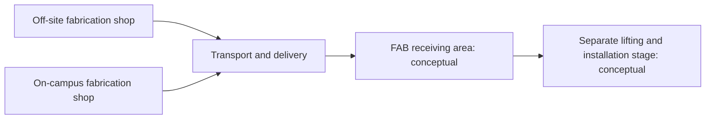

# Construction-material and module logistics

Living project, updated continuously.

Samil Logistics' [2025 company profile](https://samil-lsp.sfo3.cdn.digitaloceanspaces.com/files/SAMIL%20LOGISTICS%20%E1%84%92%E1%85%AC%E1%84%89%E1%85%A1%E1%84%89%E1%85%A9%E1%84%80%E1%85%A2%E1%84%89%E1%85%A5_20250911%201.pdf), PDF pages 20–21, identifies Samsung C&T's P-PJT units 1–4 and EUV material/module transport. It describes movement from fabrication shops inside and outside Pyeongtaek Campus to FAB buildings, with precast concrete, steel columns and modules among the cargo categories.

The following is a conceptual workflow, not a map of actual campus roads, gates or loading points:

The brochure supports the shop-to-FAB movement; receiving and installation nodes explain the workflow without establishing their locations or a particular lifting method. Adjacent photographs are illustrations, not a measured route or identification of equipment models.

The company's current [service description](https://samillogistics.com/services) separately explains cargo review, route/site checks, transport preparation, loading/securing and handover for heavy loads. These are general operating steps, not proof of the procedure used for every Pyeongtaek delivery.

Brochure operating figures are service-reference metrics, not permanent campus vehicle counts, fab throughput or construction-cost totals. No installed tool counts, dimensions or campus geometry are changed. Original photographs are not redistributed.
