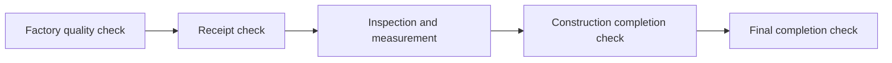

# Construction quality-management stages

Living project, updated continuously.

Reviewed source notes, 16 November 2026. This case describes management activities without assigning installed properties, acceptance results or locations to model elements.

## Named Pyeongtaek quality-management case

[HanmiGlobal's HG PRECON case page](https://www.hgprecon.com/project20.asp) describes quality checks at factory, receipt, inspection and measurement, construction-completion and final-completion stages in its VALUE section. Its PROBLEM section lists welding and cable inspection and technical certification among the quality issues to be managed. The page also describes BIM and drawing review, design-change review and coordination of building-by-building system start-up, fire-safety completion and (temporary) use-approval schedules. These are schedule-management roles, without reported dates or proof of approval. It presents completion inspection, labelled “Commissioning”, and enhanced supervision as service areas the firm established on this project. The page does not identify the client or establish the contractual chain.

The page lists March 2020–July 2022, a scale field of 496,000 m² and services labelled CM + CS. The scope of that area and its allocation to particular buildings are not established. The period is not a campus commissioning date; CS is retained without an unverified expansion. The company's description of activities is not a project-specific test report or proof that individual equipment passed acceptance. References to participation in different factories and six production lines the page describes as being developed (조성) are kept in their page context, rather than restated as current operating status.

This supports an explanatory quality-management sequence, rather than new inspection criteria or pass/fail results:

## General fab lifecycle, separate from the quality checkpoints

Samsung C&T's [9 December 2022 article](https://news.samsungcnt.com/en/features/engineering-construction/2022-12-making-the-fabs-that-make-semiconductors/) outlines planning, programming and design, then production, inspection, equipment installation and start-up, followed by total productive maintenance. This is a general company explanation. It can sit alongside HanmiGlobal's quality checkpoints; the two accounts are not combined into one verified Pyeongtaek procedure.

The article separately says P4 foundation work began in September. The sentence supplies no year. Reading this as September 2022 is an inference from publication, not an explicit start date. It gives no individual building allocation, completion, structural-member specification, lifting method or quantity. No model phase boundary is changed.
